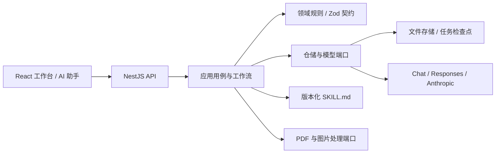

<div align="center">

# 析页 · Xiye

### 让整本教材，成为可用的结构化题库。

从 PDF 和书页图片出发，完成智能识题、跨页拼接、答案生成与逐题校对，输出标准题库 JSON。


[快速开始](#快速开始) · [产品能力](#产品能力) · [技术架构](#技术架构) · [v2.0 发布说明](docs/releases/v2.0.0.md)

</div>

---

## 全面重构，为整本教材而生

析页 v2.0 将教材处理整合为一个连续工作流：**上传材料 → 设置提取 → 智能识题 → 校对与导出**。PDF 自动转换为书页图片，工作区自动组织文件与处理进度。打开一本教材，即可在同一视图中查看原图、完整题目、选项公式、答案和来源位置。

这次重构覆盖前端、后端、模型工作流与部署体系。以完整题目为中心的交互，配合可追溯、可恢复的处理链路，让教材整理从分散的工具操作变成一套完整的产品体验。

## 产品能力

### 整本提取，连贯识别

- **PDF 与图片直接上传**：自动完成转图、页序管理和预览准备。
- **跨页题目拼接**：衔接题干、子题、解答与结论，保留原始页码和坐标。
- **多章并行**：按图片分组启动章节任务，由模型识别章节名称，汇总为一本教材。
- **题型结构化**：提取选择题选项、填空、证明题及共享题干的子题；综合练习中的独立题连续编号。
- **公式贯穿全流程**：题干、选项、答案与解析使用 LaTeX 表达，并在页面中渲染。

### 逐题校对，随时补齐

原图与完整题目并排展示，点击来源框即可定位对应题目。每道题都支持编辑、AI 修复、原文核对和缺失答案补全。发现漏题时，在相邻题目上方或下方上传题目图片，自动提取并插入指定位置。

AI 生成的答案与修复结果进入候选审核流程，确认后写入正式题库。教材基础信息可在提取后继续修改，历史版本支持查看与恢复。

### 工作持续，进度留存

每个工作区独立执行后台任务。关闭页面或退出登录，已启动的任务继续运行；取消、失败及服务重启后的任务保留检查点，可按任务状态恢复处理。题目提取与答案补全分别呈现状态，已提取的内容可以继续查看和校对。

### 独立助手，自由选择模型

AI 助手提供历史会话、居中消息区、底部输入框及公式显示，支持 Enter 发送和 Shift + Enter 换行。

**助手与题库分别配置 API 地址、密钥和模型。** 两套配置各自保存、各自测试连通性，支持 OpenAI 兼容 Chat Completions、Responses 和 Anthropic Messages 协议。个人中心汇总工作区与助手的 Token 用量。

### 标准输出，连接下一站

导出 **v1.1 题库 JSON**，包含教材信息、独立题目与题组、选项、答案和解析；同时支持 ZIP 资料包。产品版本 v2.0.0 与题库数据格式 v1.1 分别管理，便于下游系统保持稳定接入。

## 快速开始

### Docker 部署

```bash
git clone https://github.com/BY-Elysia/question_bank_auto.git
cd question_bank_auto
cp .env.example .env
# 编辑 .env，填写题库模型服务地址、密钥与模型名称
docker compose up --build -d
```

访问 **http://127.0.0.1:5002**。在教材库创建工作区、上传 PDF 或图片，按页面引导开始提取。助手模型从 **AI 助手 → 模型设置** 单独配置。

Compose 使用命名数据卷保存教材、任务、会话和配置，默认端口绑定宿主机回环地址。公网部署采用 HTTPS 反向代理，并启用 `.env.example` 中的账号登录配置：`ACCESS_REQUIRED`、`ACCESS_USERNAME`、`ACCESS_PASSWORD_HASH`。登录会话由 HttpOnly Cookie 管理，有效期 30 天。

### 本地开发

环境：**Node.js ≥ 22.21.0**，以及 Poppler 的 `pdfinfo`、`pdftoppm`。

```bash
# macOS
brew install poppler
# Debian / Ubuntu：apt-get install poppler-utils

npm ci
npm --prefix client ci
cp .env.example .env
npm run build:all
node --env-file=.env dist/app/apps/control-api/main.js
```

前端开发服务器：`npm run dev:web`，访问 `http://127.0.0.1:5173`，请求代理到后端 5002。默认数据目录为 `./workspace`，可通过 `WORKSPACE_ROOT` 配置。

### 模型配置

| 用途 | 页面入口 | 持久化配置 | 环境变量 |
| --- | --- | --- | --- |
| 教材提取、修复、答案 | 个人中心 | `profile/model.json` | `MODEL_BASE_URL`、`MODEL_API_KEY`、`MODEL_NAME`、`MODEL_PROTOCOL` |
| AI 助手对话 | AI 助手 → 模型设置 | `profile/assistant-model.json` | `ASSISTANT_BASE_URL`、`ASSISTANT_API_KEY`、`ASSISTANT_MODEL`、`ASSISTANT_PROTOCOL` |

题库支持分别指定 `VISION_MODEL` 和 `REASONING_MODEL`。视觉提取使用支持图片输入的模型；方舟 Responses 可使用显式前缀缓存复用固定指令，其他接口按配置使用常规调用。

## 技术架构

### 全栈 TypeScript，清晰的职责边界

| 层次 | 技术与职责 |
| --- | --- |
| 交互层 | React、Vite、Tailwind CSS、Radix UI、Motion；深色工作台、响应式布局和聊天界面 |
| 前端状态与请求 | 按功能组织 components / hooks / model / api；资源轮询、取消、草稿和提交状态独立管理 |
| HTTP 接口 | NestJS、Express；45 个业务与健康端点，统一错误映射 |
| 领域与应用 | 模块化单体、分层架构、端口与适配器；教材、工作区、任务、校对、个人配置及助手按职责组织 |
| 运行时契约 | Zod 校验请求、领域对象及模型输出，并生成 OpenAPI 3.1 文档 |
| 模型执行 | 8 套版本化 SKILL.md、工作流编排、输出校验、检查点与用量记录 |
| 文档与公式 | Poppler、Sharp、KaTeX；PDF 转图、预览图处理与数学公式渲染 |
| 持久化与部署 | 原子文件写入、按实体加锁、后台任务生命周期管理；Docker Compose 与持久化数据卷 |



### 模型工作流，面向可追溯的结果

**章节识别 → 跨页边界分析 → 题目提取 → 结构校验 → 答案与修复候选 → 确认导出。**

每一步由明确的输入输出契约约束。执行器固定 Skill 版本与指令哈希，保存调用用量、诊断信息和任务检查点；通过 `MODEL_TRACE=1` 可记录模型原始输出，定位格式失败与内容缺失的来源。恢复任务复用已完成的有效结果。

新增模型协议通过模型适配器接入；数据库存储通过仓储端口替换；助手上下文通过 `AssistantContextPort` 扩展。页面组件、业务规则和具体基础设施各自演进。

### 加载性能与执行模型

首页并行获取登录状态与应用脚本，教材详情、上传弹窗和公式模块按需加载。相同轮询结果保留对象引用，减少公式重复渲染；原图使用常规预览资源及邻页预加载。静态资源在构建时生成 Brotli 压缩版本。

当前部署采用 **单后端进程管理独占数据卷**，支持多个逻辑工作区独立异步运行。文件仓储与任务执行接口为后续数据库和执行基础设施扩展提供边界。

## 质量验证

v2.0 发布验证包含 **109 项后端测试、23 项 Chrome 浏览器端测**，覆盖 PDF/图片上传、章节并行、跨页拼接、逐题操作、任务恢复、导出、模型协议、配置隔离、公式与移动端布局。

```bash
npm run check       # 构建、OpenAPI 校验、类型检查和后端测试
npm run build:web   # 前端类型检查与生产构建
npm run test:web    # Playwright 浏览器端测
```

可控模型响应用于稳定回归，本地 HTTP 服务验证供应商协议。真实模型验证使用已配置的服务运行 `npm run test:live` 或 `npm run test:live:workspaces`。

## 深入了解

- [v2.0.0 发布说明](docs/releases/v2.0.0.md)
- [更新日志](CHANGELOG.md)
- [后端架构](docs/architecture.md) · [前端架构](docs/frontend-architecture.md)
- [工作台与扩展边界](docs/workbench-architecture.md)
- [识题工作流](docs/extraction-workflow.md) · [Skill 指令目录](src/ai/skills/README.md)
- [API 使用指南](docs/api.md) · OpenAPI 构建产物：`dist/contracts/openapi.json`
- [整体重构验证](docs/verification/architecture-refactor-2026-11-07.md) · [首页与助手验证](docs/verification/home-chat-2026-11-07.md)
