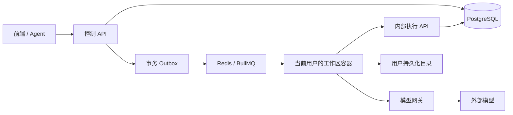

# 新版后端接口约定

版本：0.1.0。日期：2026-10-22。状态：设计契约，未实现。

结构与字段以 `contracts/openapi.json` 为准；本文定义 JSON Schema 无法完整表达的授权、跨资源一致性和事务语义。`contracts/catalog.json` 的 planned 标记明确表示能力尚未上线；实现并通过验收后才能发布 active 版本。

## 1. 运行边界



控制 API 与模型网关起初可以同进程部署；协议边界分开。每个用户至多一个活动工作区容器，容器可以有受配额约束的任务并发。前端与 Agent 调用相同的业务 API；本轮不定义聊天产品、飞书消息或 MCP 线协议，实现这些适配器时复用本契约。

身份认证由外部身份服务提供 JWT；本轮不自建密码注册、登录或刷新接口。公开 API 的 `sub` 决定 owner，`aud=question-bank-api`。内部令牌使用 `aud=question-bank-internal`，由控制服务签发，绑定 `workspaceId`、容器 generation、到期时间和操作 scopes。公开令牌不能调用内部 API，内部令牌不能调用公开 API。

所有数据库查询和资源解析都必须带当前用户归属条件。跨用户资源按 404 返回，避免通过存在性泄露信息。`ownerId`、Docker 容器 ID、宿主机路径都不是公开请求参数。生产反向代理不得把 `/internal/v1` 路由到公网；路径前缀本身不能替代鉴权。

## 2. 通用 HTTP 约定

### 地址、返回与分页

- 公开前缀 `/api/v1`；内部前缀 `/internal/v1`。OpenAPI 使用相对 server 地址，部署环境自行设置域名。
- 成功直接返回资源对象或 `{ items, page }`，不额外嵌套 `data`。204 没有响应体。
- 所有响应有 `X-Request-Id`；时间用 UTC RFC 3339，ID 为 UUID，客户端不得依赖其内部结构。
- 普通分页 `cursor` + `limit`，默认 20，最大 100。游标绑定资源、筛选条件和排序，不能跨用户复用。
- 普通列表按 `createdAt DESC, id DESC`；事件按 ID 升序、步骤按 sequence 升序、文档版本按 revision 降序。并发创建时使用游标锚点避免偏移分页的问题。
- 配置和能力注册表以有限集合返回；实现需设置用户配置数量上限，不能无限扩大响应。
- 资产上传为流式 multipart，单文件最大 250 MiB。支持 PDF、PNG、JPEG、WebP、JSON；额外校验内容签名、配额与安全文件名。

### 幂等

所有 POST/PUT/PATCH/DELETE 都要求 `Idempotency-Key`，包括 POST 形式的校验/搜索操作。键长 16–128，建议 UUID。按当前主体、HTTP 方法、规范化路由和 key 定位幂等记录。

相同 key、相同请求重放原响应；不同请求返回 409 `IDEMPOTENCY_CONFLICT`。普通记录保留至少 24 小时；Worker 模型/工具/步骤提交记录覆盖任务完整执行与恢复窗口。上传请求按元信息和内容哈希识别，不按 multipart boundary 识别。

幂等重放在资源版本前置检查之前执行，避免成功请求重试时因自身已经递增版本而返回 412。仍需重新验证调用者身份和资源归属。凭证请求的幂等指纹使用服务端密钥 HMAC 等不可逆方式；不保存明文 secret 请求体。

### 乐观并发

Project、Document、ModelProfile、Credential、AiConfiguration 使用递增 `revision`；WorkspaceRuntime 使用递增 `generation`。读取返回强 ETag，例如 `"3"`，更新要求 `If-Match: "3"`。列表内的 revision 可用于下一次写入。

- 缺失 `If-Match`：428 `PRECONDITION_REQUIRED`。
- 值与当前版本不同：412 `VERSION_CONFLICT`。
- 任务请求中的 `baseRevision` 已过期：409 `CONFLICT`，不得悄悄切到新版本。
- Proposal decision 的 `If-Match` 校验目标是对应文档，不是 Proposal 本身；apply 还必须匹配 Proposal.baseRevision。
- 不接受 `If-Match: *`。

### 错误

使用 `application/problem+json`，包含 `type/title/status/code/detail/requestId/retryable`，字段错误可附 `errors[{pointer,message}]`。

400 表示请求格式错误；422 表示结构可解析但业务约束失败；429 表示速率/额度限制并带 `Retry-After`；503 表示运行依赖暂不可用。客户端以 `code` 分支，不能匹配中文错误字符串。内部租约失效返回 409 `LEASE_EXPIRED`。错误不得包含密钥、服务器堆栈或真实磁盘路径。

## 3. 用户工作区与项目

`GET /me/workspace` 返回当前用户唯一逻辑工作区及配额。首次分配逻辑工作区可以在账户 provisioning 阶段完成，初始 runtime.state 为 unprovisioned。`PUT /me/workspace/runtime` 设置 running/stopped，返回 202 和目标 generation，通过 GET 观察实际状态。

容器状态：`unprovisioned → starting → running → stopping → stopped`，启动/停止失败进入 failed。控制器负责调谐；有非终态任务时主动停止返回 409。提交任务可触发启动工作区，任务先保持 queued。

Project 为教材或试卷项目，一个用户可有多个项目。创建后 kind 不变。归档项目拒绝新写任务、上传和编辑；保留查询与导出。软删除要求没有非终态任务和未撤回的发布快照；已有跨项目引用保留到引用释放，异步回收文件。

容器挂载其独有目录到 `/workspace`，代码随镜像位于 `/opt/app`。容器重建不删除持久化数据，旧 generation 的内部令牌失效。CPU/内存/存储/并发配额由控制层实施，不允许用户提交任意镜像、挂载或 shell 命令。

## 4. 文档与题目

PostgreSQL 是权威数据源。`DocumentContent` 是 `TextbookContent | ExamContent` 判别联合；教材含 publisher，试卷含 examType、durationMinutes。文档 kind 与项目 kind 必须一致。

统一题目结构：

- `choice`：single/multiple、选项、正确选项 ID、allowPartial。
- `free_response`：填空、简答、证明、计算、代码或 other。
- `group`：共享题干和非空叶子题列表；第一版不允许无限嵌套组合题。

实现必须执行以下跨字段规则：

1. 结构节点 ID 唯一、parent 存在、无环；题目 nodeId 指向有效节点。
2. 顶层及子题 ID 在文档内唯一；同一题不能重复出现在多个组合题中。
3. 选择题选项 ID 唯一；correctOptionIds 都属于 options。单选最多一个正确项；多选部分得分须与评分规则匹配。无来源答案时允许空正确项。
4. 分值非负；rubric 非空时总分与题目 score 一致；组合题总分从子题计算。
5. media/evidence 引用有权使用的资产；不得接受裸 URL、本地路径或指向其他用户的资产。
6. `answer.origin=none` 时答案内容为空；模型生成答案标记 generated 并由服务补充 invocationId；人工编辑后明确标为 human。
7. 所有文档修改经过统一校验，不因导入、组卷或模型来源而绕开。

人工编辑采用 `PUT /documents/{id}/content` 提交完整内容，结合 If-Match 原子生成新 revision。第一版不开放任意 JSON Patch。回滚历史版本也创建新 revision，不回退版本号。

文档任务只保存 Proposal：明确 `documentId/baseRevision/changes/validation`。支持 upsert_question、delete_question、replace_structure、replace_document。应用时整体校验最终文档，事务写入新版本并标记 Proposal 已应用。版本冲突时保留候选结果，禁止自动覆盖或静默合并。第一版不提供自动 rebase，用户重新读取并发起新任务。

`replace_document` 用于试卷组装等全量重建；与增量插题区分。模型定向修题只能修改请求中允许的字段，服务对完整 Question 做差异检查，不能仅信任模型的 changedFields。

导入任务仅创建新文档，不覆盖现有文档。旧格式通过明确的 `legacy-textbook-json` 导入适配，输出统一为 v1 结构。

## 5. 后台任务

统一入口 `POST /projects/{projectId}/jobs`，请求体 `JobCreate.request.kind` 决定工作流：

| kind | 作用 | 成功结果 |
| --- | --- | --- |
| pdf-render | 原始 PDF 转页图 | Asset IDs |
| document-import | v1 或旧 JSON 导入 | 新 Document IDs |
| textbook-extraction | 教材结构、跨页题提取 | Proposal IDs |
| exam-extraction | 试卷结构、跨页题提取 | Proposal IDs |
| question-edit | 核对、修题、公式、答案、题型 | Proposal IDs；核对无改动时可只返回步骤问题清单 |
| library-search | 自然语言题库检索 | 真实 questionVersionIds |
| exam-compose | 按分节选择已发布题目 | 整卷替换 Proposal |
| document-export | 固定版本 JSON/含媒体 ZIP | Export Asset IDs |

包含模型步骤时要求 aiConfigurationRevision；纯确定性任务不需要模型配置。创建时校验用户权限、文档版本、资产类型、模型能力和额度，冻结 Workflow/Skill/Tool/Profile 版本、构建版本、预算、截止时间。事务写入 job 与 outbox，再由调度器投递 BullMQ，避免数据库成功而入队丢失。

提交页图顺序就是处理顺序；同一跨页链顺序处理，不同项目可并行。`initialNodeId` 为空时先识别结构。prefix-cache 是调用策略，不改变 Skill 契约。answerMode=generate 时先提取题目再单独调用答案生成，不能让提取 Skill 把推导答案冒充原文。

### 状态与取消

| 当前状态 | 允许的后续状态 |
| --- | --- |
| queued | running、cancelled、failed |
| running | succeeded、failed、needs_input、cancel_requested |
| cancel_requested | cancelled、failed；已原子完成的提交允许返回已有终态 |
| succeeded / failed / cancelled / needs_input | 本任务不再转移 |

`needs_input` 是终态，用户补充材料后创建新任务。retry 只允许 failed/cancelled，生成新 jobId 并引用 retryOfJobId；可从持久化检查点恢复，继续使用冻结版本。baseRevision 已变化则 409，需显式创建新任务。

取消是合作式：queued 可直接 cancelled；running 标记 cancel_requested，通过心跳通知 Worker。标记后禁止新的模型调用，已在途外部请求可能继续完成并产生费用。终态与完成/取消竞争由控制服务原子裁决，不承诺撤销已发生的外部调用。

### Worker 租约与恢复

1. Worker 从自己的队列取得 jobId，通过 `/internal/v1/leases/claim` 领取。
2. 返回 Lease、冻结 Job、指定文档快照、输入资产相对路径和最近检查点。
3. 所有写入携带 leaseId 和 fencingToken；租约过期、容器重建或重新领取后，旧 token 的提交一律拒绝。
4. Worker 按 heartbeatIntervalSeconds 续约，读取取消标记；租约失联后停止新模型调用。
5. 产物先上传登记为不可变暂存，使用服务分配 ID。StepCommit 在事务内写步骤结果、产物关联、检查点和事件；同一步骤 attempt 重放不推进两次。
6. complete 将已登记产物提升为正式 Asset，创建 Proposal 或新导入文档并提交终态；控制服务验证 request.kind 对应的结果类型，不能让任意 Worker 导入或覆盖无关文档。
7. 磁盘写入不与 PostgreSQL 组成分布式事务：字节先完成暂存，业务事务只登记引用，孤立文件由回收器处理。

检查点用资产 ID 表示待补页/候选产物，不保存 Base64。任务不能依赖浏览器或 Python 进程内存恢复。

### SSE

`GET /jobs/{id}/events/stream` 返回 text/event-stream：

```text
id: 12
event: job.progress
data: {"id":"12","jobId":"00000000-0000-4000-8000-000000000009","type":"job.progress","occurredAt":"2026-10-22T08:00:00Z","state":"running","progress":{"completedUnits":3,"totalUnits":10,"phase":"extract"}}

```

前端使用支持 Authorization 的 fetch 流，而非依赖原生 EventSource 自定义请求头。每 15 秒注释心跳，断线使用 Last-Event-ID 恢复；事件至少保留至终态后 7 天。游标已过期时建立流前返回 410，客户端重新 GET Job 后订阅最新事件。事件可能重复，按 jobId+eventId 去重。连接断开不会取消任务。普通 `/events` 提供分页回放。

## 6. Skill、Tool 与模型网关

| Skill | 输入 Schema | 输出 Schema | 作用 |
| --- | --- | --- | --- |
| document-structure-detect | StructureDetectInput | StructureDetectOutput | 教材章/节或试卷大题结构识别 |
| question-boundary-detect | BoundaryDetectInput | BoundaryDetectOutput | 当前页与待补页的完整题范围 |
| question-extract | QuestionExtractInput | QuestionExtractOutput | 限定范围内提取，返回配图位置建议 |
| question-source-verify | SourceVerifyInput | SourceVerifyOutput | 对照来源核对并报告问题 |
| structured-output-repair | StructuredRepairInput | StructuredRepairOutput | 修复 JSON/Schema，禁止补造内容 |
| question-repair | QuestionRepairInput | QuestionRepairOutput | 根据指令修改限定字段 |
| math-format-repair | MathRepairInput | MathRepairOutput | 修复指定文本块数学排版 |
| answer-generate | AnswerGenerateInput | AnswerGenerateOutput | 生成明确标记来源的答案 |
| question-type-classify | QuestionTypeInput | QuestionTypeOutput | 建议题型及结构调整 |
| question-bank-search | LibrarySearchInput | LibrarySearchOutput | 受限工具循环检索真实题目 |

所有 Skill 都可返回 needs_input。completed 分支要求其主要输出非 null；模型自报 completed 仍须通过 Schema 和业务校验。结构修复返回 repairedJson 字符串，解析后必须按目标 Skill 输出 Schema 再校验；目标 Schema 来自当前计划白名单，不接受任意远程 URL，也不允许递归修复 Skill 自身。

公共接口提供 Skill/Tool/Workflow 注册表，用户只能绑定已有 Skill 到获授权的模型配置。第一版不接受用户上传可执行 Skill、Tool、shell、任意 schema 或任意供应商 baseUrl。

6 个工具是 read-page、crop-image、list-sources、list-nodes、search-questions、read-question。除 crop-image 创建任务暂存资产，其余只读。题库检索 Skill 只获授权 4 个题库工具；提取 Skill 默认不使用工具循环，由 Workflow 准备图像及根据裁图建议调用确定性资产服务。工具注册表并不意味着所有 Skill 都能调用所有工具。

工具执行必须匹配当前 invocation 实际返回的 toolCallId、计划允许列表、当前资源归属和预算。Tool 不接收 ownerId、SQL、任意路径或网络地址。身份和工作区由执行上下文注入。读图 contentHandle 仅供当前任务模型网关解析，不能当作公共下载链接。

### 模型配置与调用

Provider 为平台登记端点；模型配置选择 providerId/modelId/credentialId 和受支持参数。requiredCapabilities 约束视觉、工具调用和结构输出；Profile.role 只表达用途，不能代替实际能力检查。

平台凭证使用 credentialId=null；用户凭证单独加密管理。GET/list 永不返回 secret。模型配置、用户绑定及任务执行计划都有版本。配置冻结保留旧 profile，但凭证轮换使用当前有效 secret，撤销立即阻止后续调用。

内部 model-invocations 只接收任务租约、Skill 版本、调用序号、消息、资产引用及白名单 schemaRef。网关自行解析密钥、模型配置、工具定义和额度。每次实际外部尝试都记录 invocation，用量不可由 Worker 自报；task usage 由网关记录聚合。

返回三种分支：

- structured：符合 Skill 输出契约的结果。
- tool_calls：允许的、带调用 ID 的工具请求。
- invalid_output：模型响应已收到但不合规，给出原始输出产物 ID 与校验问题，Worker 经受授权产物读取接口取得内容并决定修复。

短暂网络/限流重试与工作流重提取共享全局预算。供应商超时结果不明时 invocation 标记 unknown，不承诺供应商端 exactly-once；禁止无限自动重试可能已计费的请求。公开日志与工作目录中的 request.json 均不含认证头或密钥。

## 7. 发布、组卷与导出

发布按 documentId+revision 创建不可变快照；重复发布返回同一发布记录。当前题库仅检索用户自己的已发布快照，不提供跨用户共享库。文档编辑不修改既有发布快照。

撤回发布使其不再出现在新搜索中，历史引用保留；已冻结、获授权的组卷任务可读取其输入版本。已发布题目用独立 questionVersionId 标识，防止后续文档编辑改变组卷输入。

组卷请求指定各节 questionVersionIds 和分值。服务端校验来源权限、重复题、分值以及题型结构；生成新题 ID、保留来源证据和内部来源映射，以整文档 Proposal 交付。第一版分值规则：scorePerQuestion 应用于每道叶子题；若选中组合题则作为组合题总分，按原子题分值比例分配，原总分为零时均分，并按最后一题修正舍入误差。真正实现前需用样例验证此规则。

导出固定 revision，不能在后台执行中切换成最新版本。bundle 必须 includeMedia=true，包含 manifest、question-bank.json、media/，JSON 内保留稳定 assetId，manifest 按 ExportManifest 契约映射 assetId 到包内 media/ 相对路径；导入时重新登记资产并统一改写引用。裸 JSON 同样保留 assetId，不写宿主机路径。导出本身是新 Asset，经权限校验下载。

## 8. 实现时必须补的集成验收

本轮契约测试不能证明以下运行行为，后续实现需逐项测试：

- 两个真实用户互相无法读取、修改、下载、检索或调用对方资产。
- 用户令牌不能调用内部接口；过期租约和旧容器 generation 不能写回。
- 同幂等键重复提交只有一个任务或一次文档版本推进。
- 文档并发编辑时 AI Proposal 应用返回冲突，既有编辑不丢失。
- Worker 崩溃后从已提交检查点恢复，题目与步骤不重复提交。
- 取消与模型请求竞争、模型超时结果未知、调用额度耗尽都有明确行为。
- SSE 重连去重、游标过期与终态关闭可正确处理。
- 文档导入导出、组合题、选择题、公式、媒体和发布快照可往返验证。

这是一份独立 v1 契约，不承诺旧前端直接兼容。后续按新契约适配前端，旧数据经导入适配器迁移。
