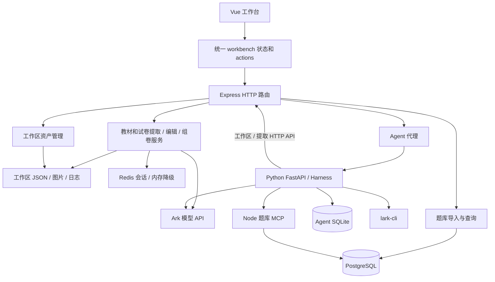

# 项目架构梳理与重构基线

核对日期：2026-10-22（Asia/Shanghai）。代码基线：`refactor/feature-split`，`d893aef4b037f599ff1da74d46616cbc443f642c`。本文区分已确认的实现、静态分析推断和建议；本轮没有修改业务实现。

## 1. 同步结果

| 分支 | 最新提交 | 提交时间（北京时间） | 状态 |
| --- | --- | --- | --- |
| GitHub `main` | `e776c03` | 2026-05-18 18:35:34 | 选择题保存归一化修复 |
| GitHub `refactor/feature-split` | `d893aef` | 2026-06-02 22:20:59 | 最新开发分支；比 main 多 30 个提交 |
| 更新前本地 `mac` | `ebcd892` | — | 是最新分支的祖先，落后 47 个提交 |

本地已切到并跟踪 `github/refactor/feature-split`。保留原 `origin` 内网远端以及本地 `mac`、`main`，新增 `github` 远端；没有重写历史或推送。切换前工作树干净。新版不再跟踪的旧 SQLite 和缓存文件已从旧分支恢复为忽略文件，原上传及产物目录保留。

## 2. 项目实际包含哪些业务

它已经是一套“题库内容生产工作台 + 题库检索 + Agent 集成”，而不只是 PDF 转 JSON。

| 业务 | 用户操作与结果 | 当前主要实现 |
| --- | --- | --- |
| 工作区与资产 | 创建教材/试卷工作区，浏览、上传、下载、清理；维护主 JSON 和多章槽位 | `workspace-store.ts`、`workspace-archive.ts`、`routes/workspace-routes.ts` |
| PDF 与媒体 | 多 PDF 转页图，保存上传图片，裁图、改写媒体 URL | `pdf-convert-service.ts`、`question-media-*.ts`、`upload-folder-import-service.ts` |
| 教材提取 | 自动逐页、跨页续题、下一页预读、手动章节片段、多章批处理 | `chapter-extraction-service.ts`、`question-bank-responses-experiment.ts`、`routes/chapter-session-routes.ts` |
| 试卷提取 | 根据大题/小题结构逐页识别并更新试卷 JSON | `exam-session-service.ts`、`routes/exam-session-routes.ts` |
| 试卷组装 | 从图片或已入库题目获得候选，预览、排序、编辑分值，确认后组成试卷 | `exam-section-compose-service.ts`、`ExamSessionPanel.vue` |
| 题目编辑与交付 | 修题、修公式、补图、改题型、生成答案、合并 JSON、下载 | 各 `question-*-service.ts`、`math-format-repair-service.ts`、`json-merge-service.ts`、`JsonVisualizerPanel.vue` |
| 题库发布与检索 | 把 JSON 显式导入 PostgreSQL，按来源/章节/题型检索，供组卷和 MCP 使用 | `question-bank-db-service.ts`、`question-bank-mcp-server.ts` |
| Agent | 聊天、附件、语音、飞书工具、确认流、题库查询、工作区操作、后台教材提取 | `agent_service/src/feishu_agent/`、`routes/agent-proxy-routes.ts` |

上述后端文件均位于 `backend/src/`；组件位于 `frontend/src/components/`。

**需要在产品上明确区分：试卷提取与试卷组装是两个用例；编辑中的题库文档与已经导入数据库的题库也是两种状态。**

## 3. 当前运行与依赖关系

- Node 入口：`backend/src/server.ts` → `app.ts`。默认端口 5001，注册 8 组路由，并可托管前端构建产物。
- Vue 入口：`frontend/src/main.js` → `App.vue` → `useQuestionBankWorkbench.js`。页面切换是 `currentPage` 和条件渲染，流程步骤由 `App.vue` 管理；没有独立的页面路由层。
- Python 入口：`agent_service/src/feishu_agent/app.py`，独立 FastAPI 服务，默认集成地址 8000。`harness.py` 处理会话、模型与工具执行；`store.py` 存 SQLite。
- Docker Compose 包含 Node 应用、PostgreSQL、Redis；**不包含 Python Agent 服务**，通过 `AEMEATH_AGENT_BASE_URL` 访问外部 sidecar。
- `createApp()` 会启动工作区清理和定时器。后续测试应把生命周期启动与应用组装分开，避免创建测试 App 时触及真实工作区。

## 4. 数据究竟归谁所有

| 数据 | 当前权威位置 | 消费者 | 重构时的边界 |
| --- | --- | --- | --- |
| 正在编辑的文档 | 工作区主 JSON，通常为 `output_json/main.json` | 提取、编辑、下载、组卷 | 文档仓储统一读写；UI 只保存显示副本 |
| 多章中间文档 | 工作区多章槽位中的独立 JSON | 多章批处理、合并 | 明确它们与主文档的关系及合并时机 |
| 资产目录与索引 | `workspace.json`、磁盘上的 PDF/图片 | 工作区浏览、文档媒体、下载 | 资产服务维护引用和清理策略 |
| 提取过程状态 | Redis；缺配置或故障时回退进程内 Map | 逐页提取和跨页队列 | 属于任务执行状态，不能代替文档版本 |
| 已入库题目 | PostgreSQL | 数据库页面、组卷查询、MCP | 作为明确的发布/导入快照 |
| Agent 消息与任务 | Agent SQLite | Harness、聊天 UI、教材任务线程 | Agent 会话与题库任务的生命周期分开 |
| 浏览器状态 | 一个大型 reactive 对象，含文件句柄、文档副本和任务状态 | 几乎所有面板 | 按功能归属拆分，公共部分只保留上下文 |

已确认的细节：

1. JSON 修改不会自动更新 PostgreSQL。通过 `import-upload` / `import-workspace-json` 显式导入；导入以每个文件为事务单元，不是整个批次一个事务。
2. PostgreSQL 中 `textbooks` 表也容纳试卷，依靠 `document_type` 区分；`chapters` 存结构节点，`assignment_questions` 存题目和父子题。现有名称带有历史痕迹。
3. `TextbookJsonPayload` 实际同时描述教材和试卷，`questions` 类型为 `unknown[]`；入口校验主要校验元信息及数组存在，完整题目约束依靠后续归一化。
4. 教材 session 分为 `chapter` 和 `question` 两份；试卷也分 `exam` 和 `exam-question`。跨页状态直接包含图片 Data URL。
5. `resolveManagedJsonInput()` 同时接受工作区资产 ID、工作区路径和旧绝对路径。导入接口还会写一份根目录 `output_json` 的兼容副本。
6. Redis 的 TTL 只作用于 Redis key；内存 Map 没有对应过期处理，读取缺失 Redis key 时又可能回退到 Map。因此不能把当前 TTL 理解成完整的会话生命周期保证。

## 5. 核心流程

### 教材

创建工作区 → 创建/导入 JSON → 上传 PDF 转页图或直接提供图片 → 初始化章节上下文 → 读取当前页和跨页待补队列 → 边界判断与可选下一页预读 → 结构化提取 → JSON 解析/修复、题目归一化和质量检查 → 按题 ID 更新文档 → 保存文档与 session → 人工校对 → 下载或导入题库。

多章批处理还会先分配独立槽位，各章提取后再合并。手工章节片段走 append-from-images；不是所有模式都走同一个自动逐页循环。

目前有两套教材实现：普通模式和 Responses 前缀缓存模式。前端默认 `original`，而 Agent 的教材任务调用 `auto-run-stream-responses`。这意味着不同入口的提取行为并非天然相同。

### 试卷

自动提取：试卷元数据 → session → 大题/小题结构识别 → 跨页提取 → JSON。

分节组装：图片识别或数据库选题 → 前端保存候选题并编辑 → 确认各节 → `finalizeExamSections()` 从空的 `chapters/questions` 重建最终文档并保存。它是整卷重建语义，不能在重构中误当作普通增量追加。

### Agent

前端聊天 → Node 代理 → Python Harness → Skill → 模型/飞书/MCP/后端 REST API。

`textbook_pipeline.py` 已经能创建工作区、保存 JSON、转换 PDF、启动教材处理、读取结果及导入数据库；使用 daemon 线程执行，并将任务记录存到 SQLite。SQLite 有记录不等于线程在进程重启后会自动恢复。

## 6. 混乱的具体来源

### A. 前端按文件拆了组件，状态与业务仍集中

`useQuestionBankWorkbench.js` 共 6,406 行，混合 HTTP 请求、状态、文件选择、模型配置、JSON 编辑、教材批处理、试卷组装、数据库和 Agent。`App.vue` 把同一个 `state/actions` 传给大多数面板。

虽然已经抽出 `useChapterSessionFlow.js`（596 行）和 `useExamSessionFlow.js`（567 行），它们仍依赖共享状态和大量注入函数。章节初始化、处理图片等请求还在 workbench 内有相似实现。

后果：一个功能的工作区切换、状态清理或错误处理容易影响其他功能；组件接口不能体现真正的依赖范围。

### B. 模型调用方式与完整业务流程绑定

`chapter-extraction-service.ts` 2,101 行，`question-bank-responses-experiment.ts` 2,169 行。后者包含完整提取编排，不只是缓存适配器。试卷提取 1,196 行，组卷服务 827 行；两者还各自实现了中文序号解析和试卷结构创建。

后果：修复一个跨页规则或题号归一化问题时，需要检查多个实现。建议先保存行为基线，再把模型策略放到同一流程的接口后面，保留模式差异。

### C. HTTP 层承担任务编排，执行权分散

教材路由 680 行，里面直接循环读图、调用模型、累计结果、记录失败、写 NDJSON。浏览器也有逐页循环；Python Agent 又维护后台任务及取消状态。

静态分析显示教材流式路由没有与连接关闭关联的取消处理。前端 AbortController 中断请求不代表后端停止模型调用或写文档；这项行为需要运行时测试确认，而不能把 UI 的“停止”当成可靠的任务取消。

### D. 保存入口不统一，规则和一致性依赖调用路径

`domains/question-json/textbook-store.ts` 的 `saveTextbookJson()` 会归一化选择题并清空媒体 caption。但 `textbook-json/save`、`import` 与 `writeWorkspaceJsonAsset()` 存在直接序列化/写文件的路径，没有统一经过它。

因此相同文档经不同入口保存，可能得到不同的规范化结果。应先确认这些语义是否都要保留，再将规则集中到一个写入用例。

当前 JSON 保存是直接 `writeFile`，文档更新与 session 更新分开完成，未见覆盖整个读取—修改—写回过程的文档锁或版本校验。并发编辑/提取存在覆盖风险，这是代码结构推断，本轮没有制造并发冲突。仅改为临时文件原子替换不足以解决丢失更新，还需要版本检查或串行化写入。

### E. 领域目录仍混入外部依赖

现有 `domains/question-json/` 的拆分有价值，但其中 `textbook-store.ts` 操作文件系统、`model-json-repair.ts` 调用 Ark、`review-logs.ts` 写日志。领域规则与基础设施还没有真正隔离。

`workspace-store.ts` 1,005 行，同时管理清单、文件写入、浏览、槽位、空间统计和清理。`question-bank-db-service.ts` 1,369 行同时做迁移、导入和查询；MCP 服务 1,793 行又直接编写 SQL。HTTP 和 MCP 应复用查询用例，避免规则分叉。

### F. 文档与代码已经出现偏差

`agent_service/README.md` 仍称 Agent 只处理聊天、飞书与题库查询，但默认 Skill 已包括 `workspace_management` 和 `textbook_pipeline`。

根 README 的主 JSON 模型只是部分情况，代码还支持多章槽位和绝对路径兼容。README 提及的清理行为也应以 `cleanupWorkspaceDerivedFiles()` 为准。后续应按实际支持的运行模式重写文档。

### G. 核心流程缺少自动化保护

Node 与 Vue 的 package scripts 都没有测试命令；仓库现有测试集中在 Python Agent。构建通过只能证明编译和打包成功，无法证明跨页合并、归一化、组卷和并发写入保持原语义。

## 7. 建议的目标边界

建议继续使用单个 Node 后端，按业务模块组织。当前规模下，首先需要明确模块职责和状态所有者。

| 模块 | 负责 | 应对外提供的能力 |
| --- | --- | --- |
| Workspace / Assets | 工作区、资产索引、路径解析、媒体、清理 | 工作区与资产 ID，不把任意磁盘路径扩散到业务层 |
| Documents | 文档 schema、版本、题目树、归一化、统一持久化 | 加载文档、带版本提交修改、导出 |
| Extraction | 教材/试卷识别规则、跨页状态推进 | 处理页/片段、返回文档变更和下一状态 |
| Jobs | 任务创建、排队、进度、取消、重试、断点 | HTTP 与 Agent 共用的任务 API |
| Editing / Composition | 修题、公式、配图、答案、合并、组卷 | 使用 Documents 提交修改；组卷明确全量重建语义 |
| Library | JSON 导入发布、查询、来源与版本关联 | HTTP 与 MCP 共用应用服务 |
| Agent Integration | 聊天、飞书、工具确认、题库任务客户端 | 调用稳定业务 API；不另建一套题库流程 |

模块内部依赖方向：HTTP/MCP 适配层 → 应用用例 → 领域规则；文件、Redis、PostgreSQL、Ark 通过接口接入。可以渐进引入，不需要一次搬迁全部目录。

前端相应按 `workspace`、`assets`、`extraction`、`editor`、`exam-composer`、`library`、`agent` 拆分。每个功能拥有自己的状态、API 调用和视图；共享上下文只保留当前工作区、文档引用等明确公共信息。先统一 API 客户端及错误/流式事件解析，再移走业务状态。

文档层建议用 `QuestionDocument` 表示共同结构，以判别联合区分教材与试卷；保留旧 JSON 的读取适配器。不要立即重命名数据库表或修改全部导出字段。

## 8. 建议的重构顺序与验收标准

| 阶段 | 具体工作 | 验收标准 |
| --- | --- | --- |
| 0：固定行为 | 为跨页、题号、LEAF/GROUP、选择题、答案策略、组卷分值建立真实小样本；模型输出用 fixture | 普通与缓存模式的差异可见，测试无需真实模型费用 |
| 1：统一文档写入 | 建立 Documents 仓储；统一 schema/归一化；原子替换加版本检查或写入串行化；保留旧路径适配 | 所有保存入口遵守同一约定；并发冲突不会静默丢数据 |
| 2：收口提取任务 | 提取路由中的循环到任务用例；显式任务状态与取消；普通/缓存模式作为策略 | UI 与 Agent 看到同一个任务 ID/状态；取消、重试行为一致 |
| 3：拆前端功能 | 先移出独立的 Agent 和数据库，再工作区/编辑器，再教材与组卷；统一 API 层 | 面板不再依赖整个 workbench；切换工作区不串状态 |
| 4：收敛题库查询 | HTTP 与 MCP 复用 Library 查询；标记导入快照及来源文档版本 | 编辑后是否重新入库可判断；两入口筛选规则一致 |
| 5：整理运行和兼容 | 区分主应用与可选 sidecar；整理旧目录、弃用接口和文档；按样本迁移 | 旧文件可读取、已有工作区可恢复、部署步骤与代码一致 |

阶段 3 的独立模块拆分可以提前做，但不宜只把 6,406 行按行数搬成几个文件。核心是状态归属和用例接口稳定。

默认保留现有功能与 JSON 兼容性。尚需在进入实现时明确的产品取舍：是否长期保留普通/缓存两种提取模式；绝对路径模式是否继续作为本地高级功能；Agent 是否作为可选独立入口；数据库导入是否明确称为“发布”。本轮没有擅自删减这些能力。

## 9. 本轮验证

- 本地 HEAD 与 `github/refactor/feature-split` 一致；工作区原有已跟踪改动为空。
- 按各自 lockfile 重新执行前后端 `npm ci`。
- 后端 `npm run build`：通过。
- 前端 `npm run build`：通过。已有警告：`/3954533.jpg` 未在构建时解析；主 JS 约 692 kB，超过 500 kB chunk 提示阈值。
- Python Agent：隔离环境安装项目与 dev 依赖，运行 `python -m pytest -q`，**27 passed**。
- 未启动会执行自动清理的后端应用；未连接真实 Ark、PostgreSQL、Redis 或飞书进行端到端验证，未运行数据库迁移。
- 本轮只新增此梳理文档，没有修改业务代码、提交或推送。

## 10. 后续阅读入口

1. `frontend/src/App.vue` 与 `frontend/src/composables/useQuestionBankWorkbench.js`：用户入口与实际功能耦合。
2. `backend/src/types.ts`、`domains/question-json/payload.ts`、`question-normalize.ts`：文档结构及归一化规则。
3. `backend/src/workspace-store.ts`、`domains/question-json/textbook-store.ts`、`state.ts`：资产、文档、session 三类状态。
4. `backend/src/routes/chapter-session-routes.ts` → `chapter-extraction-service.ts` / `question-bank-responses-experiment.ts`：教材主链。
5. `backend/src/exam-session-service.ts` 与 `exam-section-compose-service.ts`：试卷的两个不同用例。
6. `backend/src/question-bank-db-service.ts`、`question-bank-db-migrations.ts`、`question-bank-mcp-server.ts`：发布与检索。
7. `agent_service/src/feishu_agent/harness.py`、`skills/textbook_pipeline.py`、`store.py`：Agent 及第二套任务编排。

以上代码位置均以本文记录的提交为基线，后续重构应同步更新本图谱。
