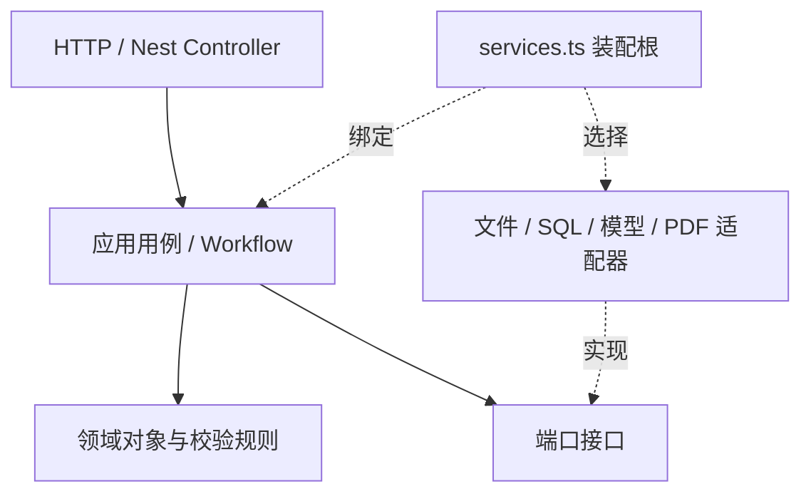

# 后端架构

## 结论与范围

采用模块化单体、分层架构和端口/适配器模式。当前只实现单工作区课本 PDF 处理，避免在业务未稳定时拆成微服务。领域和应用层不依赖 HTTP 框架、文件路径或数据库驱动，具体实现集中在装配入口绑定。



## 目录和职责

```text
src/
├── apps/control-api/
│   ├── application.ts            # HTTP 启动、异常映射、生命周期
│   └── services.ts               # 唯一应用装配根，注入具体实现
├── modules/
│   ├── textbooks/
│   │   ├── domain/               # 课本、内容、来源、范围及一致性规则
│   │   ├── ports/                # 元数据仓储、资源、页图、归档接口
│   │   ├── application/          # 上传、读取、删除、导出用例
│   │   ├── infrastructure/       # JSON 仓储、文件资源、Poppler、ZIP
│   │   └── presentation/         # 路由、HTTP 请求契约、响应流
│   ├── jobs/
│   │   ├── domain/               # 任务状态、请求、检查点
│   │   ├── ports/                # JobHandler 接口及处理器映射
│   │   ├── application/          # 排队、执行、取消、恢复
│   │   └── presentation/         # 任务 HTTP 接口
│   └── review/application/       # 核对、修复、补答案、候选审批及版本
├── ai/
│   ├── ports/                    # ModelClient、Skills、SkillCatalog、RunRecords
│   ├── workflows/textbook-extraction/ # 页队列、预读、边界、提取、检查点
│   ├── skills/                   # 六个 SKILL.md + definition.json 包
│   ├── runtime/                  # 指令执行、schema 校验、重试、版本锁定
│   ├── infrastructure/           # 本地 Skill 目录及调用记录
│   └── providers/                # Responses / Chat Completions HTTP 适配器
└── shared/
    ├── errors.ts                 # 框架无关错误与请求解析
    └── infrastructure/           # 原子 JSON 文件写入
```

Controller 调用用例，二进制响应由 Controller 转为 Nest StreamableFile。应用层只拿到流、元数据和接口，不接触 Express Response、Archiver、fs 或文件路径。JobsService 通过 JobHandler 映射执行任务，不导入具体模型工作流。领域层不反向依赖 AI 工作流。

架构测试禁止这些反向依赖，并限制单个源码文件不超过 400 行。这是可执行的依赖约束，不仅是目录命名约定。

## 扩展方式

| 需求 | 扩展位置 | 需要遵守的边界 |
| --- | --- | --- |
| 新模型供应商 | 实现 ModelClient，在 services.ts 注入 model | 返回文本与用量；支持取消；不写课本数据 |
| 新课本 AI 能力 | 新增 SKILL.md、definition.json、输出 schema 和应用用例 | 通过 Skills 调用，经过业务校验再写入仓储或创建候选 |
| 新后台任务类型 | 扩展 JobRequest/Job.kind 契约、注册 JobHandler，按需添加初始化规则 | 重新生成 OpenAPI、增加行为测试；不会自动暴露任意 Skill |
| PostgreSQL/SQLite 元数据 | 实现 BookRepository，注入 store | update/remove 按课本串行且具备事务语义；内容和修订一起提交 |
| 查询外部数据库 | 在所属业务模块定义查询端口，在 infrastructure 实现 SQL 适配器 | 用例调用参数化查询；模型输入只接收用例选出的数据 |
| 对象存储 | 实现 TextbookAssets、PageImagePort、ArchivePort，注入 assets | 业务层不感知本地路径或存储 URL |
| 数据库记录模型调用 | 实现 RunRecords，注入 records | 保留指令版本/哈希及用量，不记录 API 密钥 |

`test/repository.test.mjs` 使用真实 SQLite 测试适配器运行相同仓储契约和 HTTP → 解析 → 审批 → 导出流程，证明替换数据库不需要改 Controller 或业务用例。SQLite 示例采用 JSON 列，仅用于替换验证，不是生产数据库迁移方案。

`test/extension.test.mjs` 动态加入一个章节总结 Skill，并替换任务处理器，验证执行器与调度器的扩展入口。当前运行上下文仍以课本和任务为中心；与课本无关的 AI 功能应建立自己的业务模块和上下文，可以复用 ModelClient，不应塞进课本领域对象。

没有开放模型自主执行 SQL 或通用工具协议。未来需要工具调用时，由应用层提供明确的工具端口、输入校验和数据访问范围，再由适配器实现。

## 数据与修订

Content 是统一内容块，kind 区分 heading、paragraph、formula、figure、table、example、question、answer。每块有稳定 ID、章节 ID 及来源 `[{page,box}]`。box 为 0–1 范围的 `[left,top,right,bottom]`。图片通过来源页图与区域保留。

Question 保留题号、题型、题干、选项、答案及共享题干下的子问；沿用旧版一层 GROUP/子问语义。更深的印刷嵌套保留在相应小问题干中。原文答案有页码坐标；AI 与人工答案分别标记 origin。缺答案以 null 表示。

Document 修订与任务检查点分开：每页结果先写任务 stage，选定范围处理完后替换正式文档并增加 revision。失败不破坏已发布修订。完整解析使用新 stage，局部重跑保留范围外内容。

人工编辑、候选接受和恢复要求 expectedRevision。接受候选逐项比较当前内容与 before，阻止过期覆盖；互不冲突的候选可依次接受。拒绝候选不改变文档修订，恢复会创建新修订。

## 默认文件工作区

```text
workspace/books/<book-id>/
├── source.pdf
├── pages/<pdf-page>.png          # 按需缓存
├── state.json                   # 正式文档、任务、检查点、候选
├── revisions/<revision>.json    # 不可变文档快照
└── runs/<job-id>/
    ├── <skill-id>.json           # 任务固定的版本/指令哈希
    └── <invocation-id>.json      # 模型、用量、时间、指令哈希
```

文件仓储先写修订再用 state.json 原子替换发布；未成功发布的未来修订不可读取。临时文件写入后 fsync、rename，按课本进程内串行更新；模型调用不占仓储锁。资源与元数据独立，数据库替换后 PDF/PNG 仍可保留在卷上。

目前 BookRepository 以整本课本聚合为事务边界，适合本轮范围。未来大规模列表、检索和分析应增加分页查询端口及索引，避免把所有课本完整加载到内存；不能仅替换数据库驱动就认为具备大规模查询性能。

## 模型与部署边界

支持 MODEL_PROTOCOL=responses 或 chat，兼容旧版 ARK_* 配置。MODEL_NAME 为默认模型，VISION_MODEL / REASONING_MODEL 可覆盖。默认 HTTP 超时 180 秒；429、5xx、网络错误和超时最多尝试 3 次，取消信号中断请求及退避等待。

SKILL.md 是受控任务指令，页图和用户材料作为数据发送。执行器强制 schema 和范围校验；恢复时检查 Skill 版本及指令哈希。

每本课本同时运行一个任务；每个卷由单进程独占。Dockerfile 打包 Node 和 Poppler，一个容器加一个卷构成工作区。数据库接入本身不会解决多实例调度：水平扩展还需要持久任务队列、租约/分布式锁、独立 worker 和数据库迁移。用户管理、鉴权、多租户调度仍不在本轮范围。
