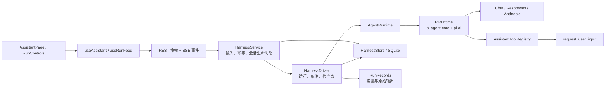

# AI 助手 P0：持久化交互 Harness

助手支持流式回答、插话、打断改向、追加任务、停止、询问后继续、失败恢复、会话管理和历史分页。关闭浏览器、切换页面或退出登录不会取消后台运行。

## 架构与分工



采用 `@earendil-works/pi-agent-core`、`@earendil-works/pi-ai`，均固定到 1.5.0。pi 承担供应商流式适配和单轮工具执行；产品自己的 Harness 掌握运行状态、持久队列、用户交互、恢复与事件。数据库和应用层不依赖 pi 类型，框架对象只存在于 `PiRuntime` 的不透明检查点中。

目录：

```text
src/modules/assistant/
  domain/                 会话、Run、输入、交互、事件契约
  application/harness/    服务与后台执行器
  application/tools/      应用工具定义与校验
  ports/                  Runtime / Store / ToolRegistry / Context
  infrastructure/runtime/ Pi 适配器、非流式注入适配器
  infrastructure/         SQLite、旧 JSON 迁移
  presentation/           Nest 控制器与 OpenAPI 路由表
client/src/features/assistant/
  api/                    HTTP 与 SSE 适配
  hooks/                  会话状态、分页、草稿、增量事件
  components/             对话、运行状态、用户问题卡片
```

教材继续使用原有 `ModelClient.complete` 和 Workflow。助手使用独立模型设置，保持原有题库提取行为。

## 运行与交互语义

- 一个会话同一时间只有一个活动 Run；不同会话独立运行。
- **插话**：持久化后，在当前模型/工具步骤结束时优先消费。
- **打断并改向**：取消当前 provider 流，保留已显示文字，在下一轮应用新要求。等待确认时打断会取消原问题，不会把取消当成同意。
- **完成后追加**：优先输入处理完后消费追加队列。
- **停止**：Run 变为 cancelled，保留部分消息；重新生成创建关联的新 Run。
- **模型询问**：工具返回持久化 interaction，Run 进入 waiting_input 并释放模型连接；答复通过 interactionId 关联，全部必要问题回答后继续。
- **断线重连**：SSE 事件持久化，支持 Last-Event-ID / after 游标。慢连接受写入背压限制。
- **进程重启**：运行中的任务标记 interrupted，用户点击“继续任务”；waiting_input 保持等待，问题不会丢失。不会自动重复启动所有模型请求。
- **幂等**：start 和 input 使用 requestId；重复相同提交不重复执行，冲突内容返回 409。答复重复提交同一答案也幂等。

状态流：queued → running → completed / waiting_input / failed / interrupted / cancelled。等待答复后回 queued；失败或中断可从检查点继续。

## 持久化与负载

`assistant/harness.sqlite` 使用 WAL，保存会话、运行检查点、输入队列、交互与有序事件。启动时一次性导入原 `conversations/*.json`，保留原文件用于备份；已删除会话不会再次导入。消息、运行检查点和事件分表保存；流式文字只更新对应消息行与事件，不重写历史运行检查点。列表只读取索引摘要。会话状态接口返回最近 50 条消息和最新 Run，更早消息由 cursor 向前分页获取。

前端使用 SSE 更新文字，状态事件触发合并刷新；运行中每 10 秒进行一次兜底查询。等待答复和已结束的会话不持续拉取全文。草稿按会话隔离，历史公式按需渲染。

运行记录保留 Skill 版本与指纹、原始模型消息、工具调用、用量和完成状态；私有文件权限为 0600，检查点与系统指令不进入前端 Run 响应。用量继续汇入个人中心。没有返回用量的中断请求不会虚构 token 数。

当前部署保持单 Node 进程、独占数据卷；SQLite 负责事务持久性，进程内执行器负责活动请求。多实例部署需要增加任务租约和独立 worker。上下文初始历史沿用 40 条 / 64000 字符预算；长运行自动摘要放入后续阶段。

## 扩展边界

- `AgentRuntime`：替换执行框架，教材模型端口不受影响。
- `AssistantToolRegistry`：登记工具 schema、执行器和暂停结果。P0 只注册询问工具；后续数据库工具通过这里接入明确的权限和审计，不在控制器直接执行 SQL。
- `AssistantContextPort`：注入参考资料；下一阶段增加结构化来源和工作区作用域。
- `HarnessStore`：替换存储，后续扩展任务租约和跨进程队列。
- `SkillCatalog / RunRecords`：指令版本与执行诊断复用现有基础设施。

P0 的“确认”用于对话方案选择；数据库写入授权、附件、多代理与自动上下文压缩仍属于后续阶段。
