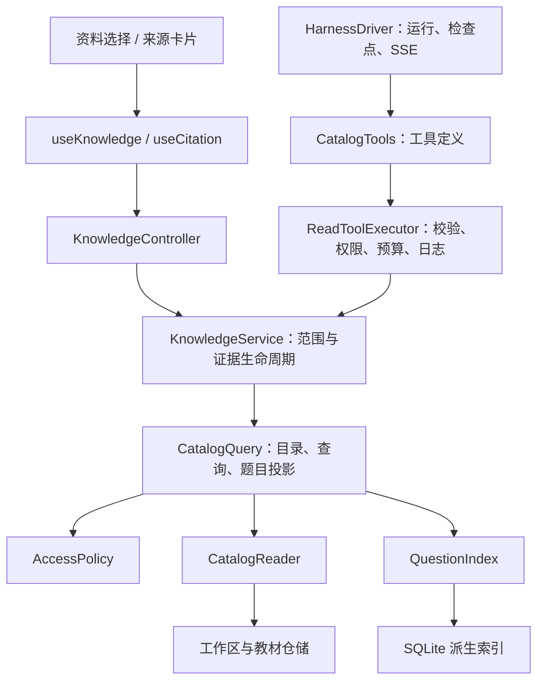

# AI 助手 P1：教材查询与来源引用

P1 在 P0 持久化 Harness 上接入只读教材工具。用户在对话中选择资料范围，也可以从具体题目点击“向助手提问”，带入工作区、题目和修订定位。

## 分层与依赖

- `catalog/domain` 定义题目地址、筛选与查询结果；不依赖数据库或 HTTP。
- `catalog/application` 组织权限检查、版本校验、章节路径与完整题目投影。
- `catalog/ports` 定义 `CatalogReader / QuestionIndex / AccessPolicy`，数据库或搜索引擎可以独立替换。
- `catalog/infrastructure` 实现现有文件仓储读取及参数化 SQLite 查询。
- `assistant/application/tools` 定义工具和通用只读执行器；pi 适配器仅负责模型与工具协议，不访问数据库。
- `assistant/application/knowledge` 管理对话资料范围、来源证据、版本状态和工具事件。
- 前端 `api / hooks / components` 分别负责请求、状态和展示，继续复用公式渲染。

## 数据与权限

当前部署仍是单账号登录门禁，`SingleAccountCatalogAccess` 将服务器配置的账号绑定到工作区读取策略；多用户 ACL 可通过 `AppOptions.catalogAccess` 注入。P1 不宣称已提供多租户隔离。

权限由服务器生成的 `ToolContext` 传递，包含账号、会话、运行和资料范围版本。工具参数不能指定账号或扩大范围。读取题目同时检查账号权限与用户选定的工作区；每个模型步骤及工具前后重新检查权限和运行状态。运行中修改资料范围返回 409；修改后从新上下文边界开始，旧教材消息保留展示但不再送入新模型上下文。

工作区列表仅返回可访问的摘要。教材题目、候选答案和原图均不提供通用文件读取或任意 SQL 工具。工具只读，不修改教材与答案。每次运行最多 48 次资料工具调用；查询每页最多 20 题、单次结果最多 60000 字符。取消信号贯穿执行边界；当前文件读操作本身不可强制中断，结果返回前再次检查取消状态。

## 工具契约

| 工具 | 作用 |
| --- | --- |
| `list_workspaces` | 列出账号可用工作区摘要与已选资料 |
| `get_workspace_outline` | 获取所选教材目录、版本和已发布题目统计 |
| `search_questions` | 按关键词、章节、题型、答案状态分页查询 |
| `get_question` | 读取完整题干、选项、子题、答案及可引用证据 |
| `get_source_excerpt` | 获取识别原文节选、来源页码和坐标 |

查询采用 Unicode 规范化与参数化子串匹配，多关键词同时匹配；P1 未接入向量检索。搜索结果先返回摘要与规范化 `questionRef`（包含工作区、修订、题目、root/子题定位），模型原样传回以读取完整题目，避免 nullable 子题索引被模型重建为 0。共享题干子题携带父题干与来源，独立题保持独立。来源内容来自教材结构化结果，助手未直接进行图像识别。

## 来源证据

服务端生成证据 ID，并保存 `workspaceId / contentId / childIndex / revision / sources / excerpt / answerOrigin / answerReview`。模型使用 `[来源:e_…]` 引用；最终消息只绑定本次运行真实读取的证据，伪造标记替换为“来源未验证”。这验证来源身份，不等同于自动证明回答与原文在语义上完全一致。

来源卡片显示教材、题号、页码及答案来源；待确认 AI 答案明确标注。点击可看正常预览图与来源框，继续定位教材题目。教材更新后显示版本变化和原引用节选；删除后展示失效状态；撤销资料范围或权限后不能继续读取来源。图片接口同样校验权限，使用 private/no-store，不加载高清图。

## 存储与追踪

- `assistant/harness.sqlite`：现有会话、运行、检查点、事件。
- `assistant/knowledge.sqlite`：资料范围、证据快照、工具调用参数/结果/状态。
- `catalog/questions.sqlite`：按教材修订与更新时间更新的派生索引，可删除重建。
- 私有模型运行记录继续保存完整系统指令、原始输出、工具消息和 Token 用量；不写入 Git。

只在用户查询选定教材时建立/刷新索引，不在首页启动时加载全题库。记录工具状态通过现有 SSE 传送，界面不为每次工具事件重新拉取全部对话。研究 Skill 位于 `src/ai/skills/textbook-research/SKILL.md`，完整指令参与运行指纹。

## 新增 HTTP 接口

| 方法 | 路径 | 用途 |
| --- | --- | --- |
| GET | `/api/assistant/knowledge/workspaces` | 可选择的工作区 |
| GET | `/api/assistant/conversations/:id/scope` | 当前资料范围 |
| PUT | 同上 | 保存 `{workspaceIds, focus}`，focus 可为空 |
| GET | `/api/assistant/conversations/:id/citations/:citation` | 来源与版本状态 |
| GET | `/api/assistant/conversations/:id/citations/:citation/pages/:page/image` | 受保护的正常预览图 |

保留 P0 的发送、停止、插话、询问确认、恢复与事件接口。新增数据库功能时，按领域增加 Query Port 和工具定义，复用执行器、权限与证据机制；写操作应另设命令与审批契约，不混入只读查询端口。
