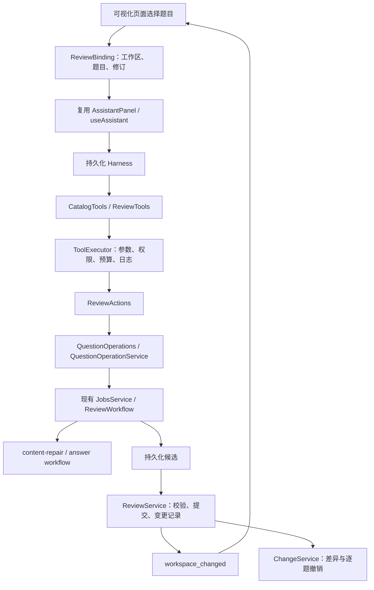

# 可视化页面 AI 协作 · 首期闭环

版本 2.3.1，2026-11-09。可视化页面中的“向助手提问”打开内嵌面板，保留当前教材位置。首期支持原图核对、题目修复、缺失答案生成、修改差异、逐题撤销，以及现有的插话、停止、询问和恢复。

## 运行链路

Agent-Native 的共享业务操作、上下文感知和结果同步思想用于本次设计；保留现有 NestJS、pi 与自有 Harness，不引入第二套应用框架或数据库。

## 分层与复用

- `assistant/ports/deferred-tasks.ts`：后台任务等待与取消端口，运行器不依赖具体教材工作流。
- `assistant/application/actions/ReviewActions`：仅负责目标授权与变更通知，通过 QuestionOperations 调用审核业务能力。
- `review/application/QuestionOperationService`：编排修复、答案任务及候选提交；按当前任务返回变更，统一取消与撤销。
- `assistant/application/tools`：工具描述与输入输出适配；统一 ToolExecutor 负责参数、权限、调用预算、超时和日志。文本、原图和后台任务使用同一执行协议。
- `review/application/ReviewService`：页面接受候选和 AI 自动应用共用版本检查、内容校验和原子提交，保留 AI 答案来源。
- `review/application/ChangeService`：按内容快照撤销，不回滚整本教材。修改记录与教材提交保存在同一 Book 原子写入中。
- `assistant/infrastructure/runtime/PiRuntime`：仅转换模型协议、图片和工具结果；不访问教材仓储。
- 前端通过 assistant 模块公开的 `AssistantPanel` 嵌入；页面不复制聊天请求或状态管理。`ReviewAssistantPanel` 管理教材宿主，`AssistantPage` 管理独立聊天宿主，共用 `ConversationView`。`useReviewBinding` 管理目标和修改记录，以教材修订号刷新；侧栏不加载独立聊天历史或资料选择器。

## 上下文与授权

普通助手会话默认只读。内嵌面板发送消息前，通过现有 scope 接口提交选中题目与 `allowEdits:true`；没有选中题目不能开启修改模式。模型没有修改 scope 的工具。

Run 捕获不可变的目标与权限范围。切页、关闭面板或切换题目不会改变已经启动的操作目标；下一轮消息重新绑定当时选中的题目。运行中的插话保持该 Run 的目标，可以调整处理要求；要更换目标应先停止当前运行。

只有明确要求修复或补答案时调用修改工具；诊断和讲解保持只读。歧义通过现有 request_user_input 询问并继续。所有写工具还会在代码中校验账号、范围、当前题目、运行状态及修订。

原图工具只读取焦点题目来源页及相邻一页，使用正常 preview 图片，不请求 detail 高清图。图片按需进入工具结果；聊天界面不会随着每次输入上传整页截图。

## 持久化执行

`run_question_action` 返回工作区和任务 ID，模型步骤随即结束。Harness 将该任务引用和模型检查点写入 `AssistantRun.deferred`，在没有模型连接的情况下等待教材任务，然后提交候选并将结果送入下一步对话。

- 离开页面或刷新不取消任务。
- 服务重启后运行标记 interrupted；点击继续恢复持久化任务及候选，不重复提交。
- 停止会取消当前 Run 创建的教材任务；提交临界区再次检查取消信号。
- 幂等键绑定 Run、已应用的用户指令和操作类型。模型重复调用复用任务；打断后的新指令获得新键，不会恢复旧要求。
- 本轮已经提交的修改不会因为停止而隐式回退，可通过明确的撤销操作恢复。

## 修改与撤销

每条变更保存 `before / after / actor / principalId / runId / revision / at / undoneAt`。页面展示修改前后内容，公式复用原有渲染器。

撤销比较当前题目与原变更的 after 快照：一致才应用 before。其他题目后续编辑保留；同一题目被再次修改时返回冲突，不覆盖。已撤销记录重复提交不会再次增加修订。

AI 提交候选保留 `ai_generated/source/human` 的原始答案来源，并标记已接受。人工接受候选也产生相同结构的变更记录。

## 新增接口与工具

| 接口 / 工具 | 作用 |
| --- | --- |
| `PUT /api/assistant/conversations/:id/scope` | 增加 allowEdits，默认 false；修改模式要求 focus |
| `GET /api/workspaces/:id/changes` | 最近 30 条变更，需工作区访问权限 |
| `POST /api/workspaces/:id/changes/:change/undo` | 请求 `{revision}`，撤销指定变更 |
| `read_question_page` | 读取焦点题目的原图及相邻页 |
| `run_question_action` | repair 或 answers，复用后台工作流 |
| `list_question_changes` | 当前题目最近变更 |
| `undo_question_change` | 撤销当前题目的指定变更 |

已有 HTTP 接口保持兼容，Book 新增 changes 默认空数组；旧会话默认没有可执行修改权限。现有 OpenAPI 合计 64 个业务/健康端点，10 套版本化 Skill。

## 首期边界

框选补题、自动拆分合并、跨页归属结构调整留到后续阶段。首期通过现有修复流程修改单个完整题目；不暴露任意 SQL、文件写入或整本教材替换工具。修改记录采用现有持久化教材仓储，数据库迁移可经仓储端口替换。
