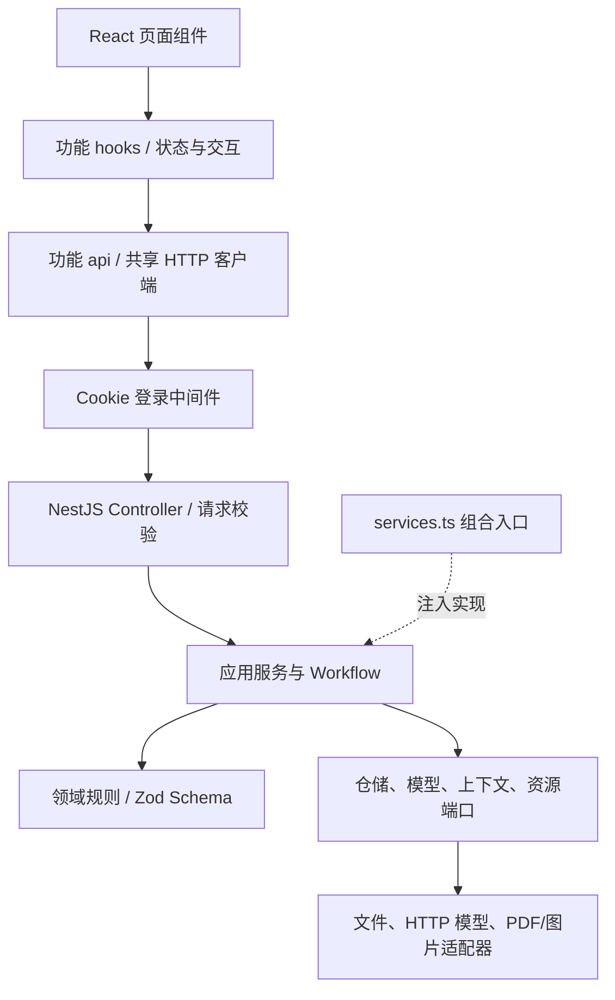
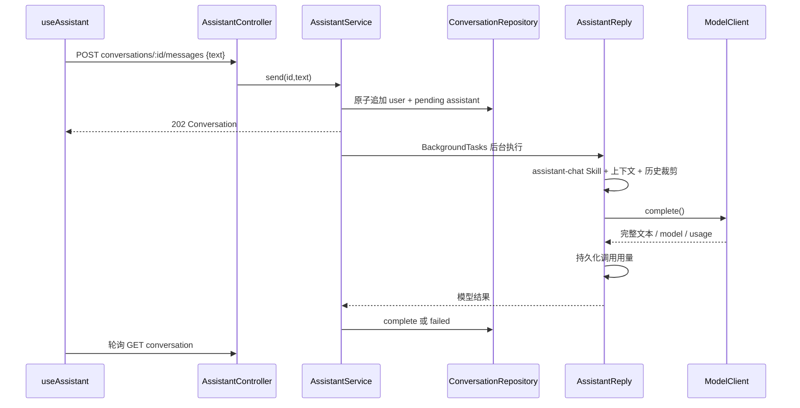

# v2 架构基线与下一版 AI 助手规划

更新：P1 教材查询、资料范围与来源引用已实现，见 [P1 架构](../assistant-knowledge.md)。P0 已实现，当前架构与交互语义见 [助手 Harness](../assistant-harness.md)。下文保留 v2.0 基线分析，P2 继续作为后续路线。

整理日期：2026-11-07。当前基线为 main 上的 v2.0 产品实现。本文件区分已实现能力与下一版设计建议；接口全表见 [后端接口清单](../backend-interface-inventory.md)。

## 1. 当前系统结构



| 模块 | 当前职责 | 主要位置 |
| --- | --- | --- |
| workspaces | 材料准备、章节分组、提取编排、工作区视图与状态 | `src/modules/workspaces` |
| textbooks | 文档、原图、版本、资源与题库导出 | `src/modules/textbooks` |
| jobs | 后台任务启动、取消、恢复及处理器调度 | `src/modules/jobs` |
| review | 原文核对、修复、答案生成与候选审核 | `src/modules/review` |
| questions | 上传补题图片、提取、定位插入与原子提交 | `src/modules/questions` |
| profile | 题库/助手独立模型配置、连通性测试、用量汇总 | `src/modules/profile` |
| assistant | 对话持久化、消息状态与后台回复 | `src/modules/assistant` |
| ai | 协议适配、Skill 执行、教材 Workflow、缓存与调用记录 | `src/ai` |
| shared | 错误、认证、按实体写锁、后台执行生命周期 | `src/shared` |

前端模块位于 `client/src/features`，按 `components / hooks / api / model` 分工。`shared/contracts.ts` 是后端类型进入前端的统一入口。配置表单共用渲染与状态逻辑，scope 决定访问题库还是助手配置接口。

运行拓扑：单账号门禁、单后端进程、独占持久化数据卷；多个工作区及对话按身份独立执行。`KeyedLock` 是进程内串行写锁，`BackgroundTasks` 是进程内执行句柄管理器；持久化状态与恢复语义由业务用例负责。

## 2. 助手当前调用链



### 已实现

- 新建、列表、读取会话和发送文本；对话列表按更新时间排序。
- 消息包含 `id / role / content / status / error`，状态为 `pending / complete / failed`。
- 同一对话一次生成；不同对话可独立执行。离开页面或退出登录不取消生成。
- 单条输入最多 20000 字符；会话达到 200 条消息后要求新建。
- 模型上下文保留最近最多 40 条已完成消息、总计最多 64000 字符；按字符预算裁剪。
- 助手独立模型客户端和配置；Chat、Responses、Anthropic 三种协议适配。
- `AssistantReply` 编排 Skill、上下文、模型调用与用量记录；调用超时信号为 180 秒。
- 完整文本返回后更新消息；前端在生成期间每 2 秒轮询会话。
- 服务重启后 pending 消息标记失败；当前助手不会自动续接被中断的模型生成。

### 已有扩展入口

| 接口 | 当前实现 | 下一版复用方向 |
| --- | --- | --- |
| `ConversationRepository` | FileConversations | 会话与消息存储、分页查询 |
| `ModelClient.complete` | HttpModelClient | 增加可选流式能力，保持教材 complete 契约稳定 |
| `AssistantContextPort.resolve` | EmptyAssistantContext | 接入选定工作区、题目和数据库只读检索 |
| `SkillCatalog / RunRecords` | 文件 Skill 与调用记录 | 助手指令版本、执行追踪与用量归因 |
| `SettingsRepository` | 分用途 FileSettings | 模型配置扩展与能力描述 |
| `AppOptions` | 组合入口注入 | 替换存储、上下文或模型实现 |

## 3. 下一版需要补齐的结构

1. **独立生成任务 Run**：现在生成状态直接挂在 assistant 消息上，没有独立 runId、取消 API、重试 API或事件序号。流式输出、重连和恢复应共用 Run 模型。
2. **流式协议**：当前 `ModelClient` 只有完整响应的 `complete()`；先扩展流式端口与标准事件，再适配供应商，避免页面处理供应商原始事件。
3. **会话生命周期**：当前没有重命名、删除、消息分页和生成历史。文件仓储的列表会读取全部会话全文再投影，数据量增长时需独立列表查询。
4. **结构化上下文**：目前 `references` 是字符串数组，缺少来源 ID、引用位置和访问作用域。接教材/数据库前将其升级为可追溯的引用对象。
5. **工具执行层**：当前没有模型工具调用协议、注册表或执行循环。上下文读取端口与工具执行端口分别承担职责。
6. **助手可观测性**：当前调用记录存 usage，但 `instructionHash` 为空；失败消息统一提示，缺少可查询的失败分类和 run 级诊断。下一版补齐指令指纹、供应商请求 ID、终止原因与用量状态。

## 4. 建议的下一版交付顺序（待实施）

### P0：完整聊天基础

会话重命名/删除、消息分页、流式回答、停止生成、失败重试、断线重连、Run 状态与事件持久化。

建议新增领域对象：`Conversation`、`Message`、`AssistantRun`、`RunEvent`；run 保存会话/消息关联、模型与配置版本、状态、事件游标、错误及用量。消息承载展示内容，run 承载执行事实。

| 建议 API | 用途 |
| --- | --- |
| `PATCH /api/assistant/conversations/{id}` | 重命名与会话属性 |
| `DELETE /api/assistant/conversations/{id}` | 删除会话，明确活动任务处理规则 |
| `GET /api/assistant/conversations/{id}/messages?cursor=...&limit=...` | 消息分页 |
| `POST /api/assistant/conversations/{id}/runs` | 创建生成任务，接收客户端幂等键 |
| `GET /api/assistant/runs/{runId}` | 查询状态与用量 |
| `GET /api/assistant/runs/{runId}/events` | SSE 事件流，支持事件游标续读 |
| `POST /api/assistant/runs/{runId}/cancel` | 停止生成 |
| `POST /api/assistant/runs/{runId}/retry` | 创建关联原任务的新运行记录 |

保留现有发送消息 API 作为兼容入口，内部转交同一 Run 用例。客户端断开 SSE 不等于取消任务；取消必须由明确的取消命令触发。

### P1：教材上下文与只读数据能力

支持选择工作区/题目、检索教材和引用来源跳转。`AssistantContextPort` 接收明确的资源作用域，返回结构化引用；数据访问通过应用查询服务与仓储端口完成。先交付只读能力，覆盖查题、定位原文、解释选中题目。

### P2：工具调用与可控操作

建立 `ToolRegistry / ToolExecutor`，每个工具声明输入输出 Schema、权限作用域、超时与副作用类别。模型选择工具，应用层校验并执行。修改题目、提交修复或创建任务等写操作复用现有业务用例，输出可审核的操作结果。

## 5. 下一版目录建议（待实施）

```text
modules/assistant/
  domain/          # Conversation、Message、Run、Event、Citation
  application/     # 会话管理、消息分页、Run 编排、上下文组装
  ports/           # Conversation/Message/Run/Event repository、Context、Tools
  infrastructure/  # 文件或数据库适配器、事件存储
  presentation/    # 会话 API、Run API、SSE 事件映射
ai/
  ports/           # 完整响应与流式响应契约、模型能力
  providers/       # 各协议到标准事件/结果的转换
  skills/          # 指令与版本
```

保持模块化单体，不因新增聊天功能拆分部署单元。工具调用循环归助手编排，协议解析归模型适配器，数据库驱动归仓储实现，页面只消费稳定的业务事件。

## 6. 下一版验收重点

- 同一请求重复提交只产生一个运行；同一对话运行互斥，不同对话互不阻塞。
- 断开网页后继续生成；重连不丢失、不重复事件；取消后不会继续提交内容。
- 进程中断后的运行状态与已有内容一致，重试不覆盖旧结果。
- 工具与上下文按资源作用域读取，写操作经过业务校验；引用可定位原文。
- 每个运行记录模型、指令版本、终止原因及供应商实际 usage；缺失 usage 明确标记。
- 题库现有接口、提取工作流和导出格式通过回归。
