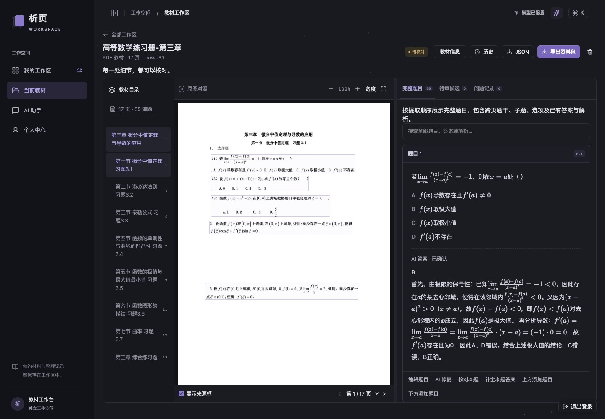
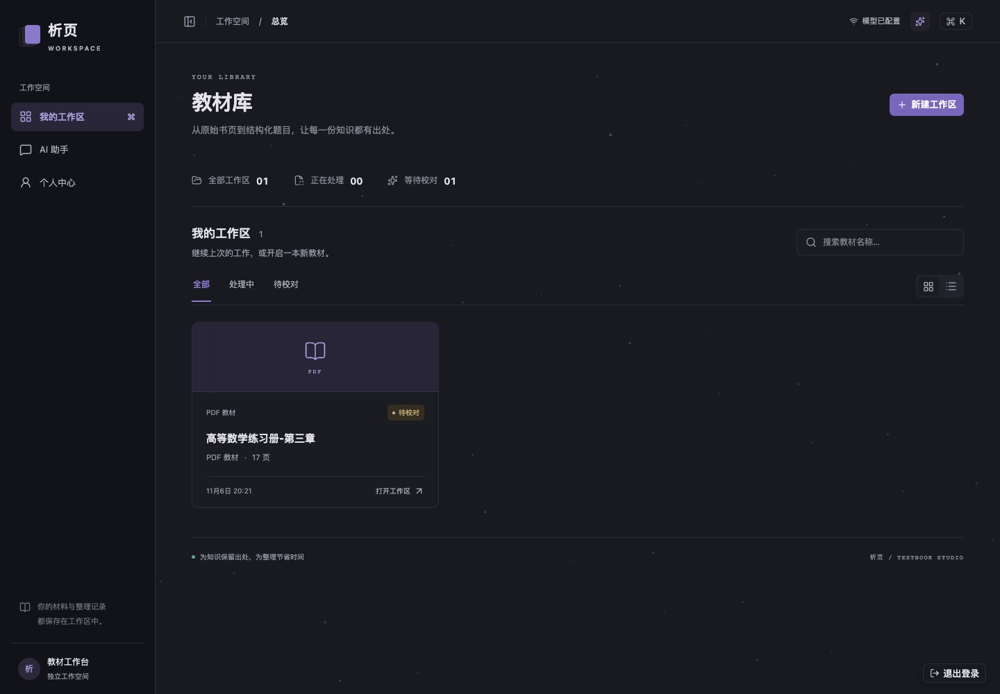
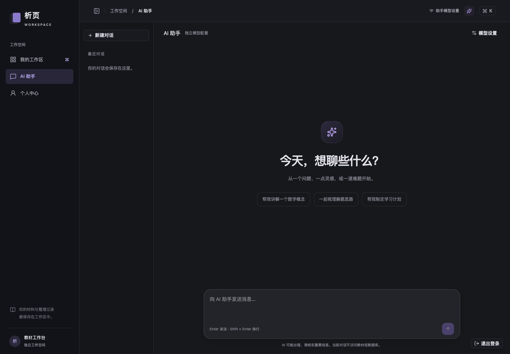

# 析页 v2.0：从整本教材，到结构化题库

**一次覆盖产品体验、技术架构和模型工作流的全面重构。**

析页 v2.0 正式发布。上传一本 PDF 或一组书页图片，系统自动准备材料、识别章节、提取题目并整理答案。你可以对照原图逐题校对、补齐漏题、修复内容，最终导出可直接接入下游系统的标准题库 JSON。



## 一条完整的教材处理链路

PDF 自动转图、工作区自动组织资料，多章任务可并行处理。跨页题干、子题、解答与结论沿页序衔接，原图页码和坐标贯穿整个流程。

综合练习中的选择题和填空题按独立题目连续编号，共享题干的题组保留层级。题干、选项、答案和解析统一支持数学公式。



## 以题目为中心的校对工作台

全新深色界面把原图与完整题目放在一起。点击来源即可定位；编辑、AI 修复、原文核对、答案补全直接作用于当前题目。发现漏题，在题目前后上传图片即可重新提取并插入。

AI 生成与修复结果经过候选确认进入正式文档。教材基础信息支持后续编辑，历史版本可查看与恢复。后台任务独立运行，关闭浏览器后仍继续处理，检查点让失败恢复拥有清晰起点。

## 一个独立的 AI 对话空间

全新助手带来熟悉的 Web Chat 体验：历史会话、居中消息、底部输入框、快捷提问和公式显示。助手与题库拥有独立的模型配置、密钥和连通性测试入口，支持 Chat Completions、Responses 与 Anthropic Messages。

个人中心集中展示工作区和助手的 Token 用量，让模型调用可观察、可管理。



## 为持续扩展建立技术基础

- **全栈 TypeScript**：React / Vite 前端与 NestJS / Express 后端统一类型语言。
- **模块化分层**：页面、状态、请求、应用用例、领域规则和基础设施各司其职。
- **契约驱动**：Zod 校验请求与模型输出，自动生成 OpenAPI 3.1；本版提供 45 个业务与健康端点。
- **8 套版本化 Skill**：覆盖结构识别、跨页分析、内容提取、补题、修复、核对、答案生成和普通对话。
- **可恢复执行**：独立任务生命周期、按实体写锁、原子提交与持久化检查点。
- **明确扩展入口**：模型供应商通过适配器接入，存储通过仓储端口替换，助手通过上下文端口接入后续数据能力。
- **加载优化**：启动请求并行、页面资源按需加载、Brotli 静态压缩、预览图及邻页预加载。

## 经验证的交付

109 项后端测试、23 项 Chrome 浏览器端测通过。线上完成教材原图、公式、题目定位、移动布局及独立助手接口复查。

首页三次冷启动现场测试的中位数从 **5.24 秒降至 3.60 秒**，约减少 **31%**；应用脚本实际传输量从约 **64 KB 降至 47 KB**。测量包含公网网络波动，完整记录见[性能验证](../verification/home-chat-2026-11-07.md)。

## 获取与部署

```bash
git clone --branch v2.0.0 https://github.com/BY-Elysia/question_bank_auto.git
cd question_bank_auto
cp .env.example .env
# 配置模型服务
docker compose up --build -d
```

访问 `http://127.0.0.1:5002`，从教材库创建第一个工作区。生产部署使用 HTTPS 反向代理和账号登录，数据通过 Docker 命名卷持久化。

## 版本与升级

- 应用版本：**v2.0.0**；标准题库导出格式：**v1.1**。
- v2 使用全新的前后端和工作区 API。旧版部署升级时，保留原始教材及已导出的 JSON，使用独立的 v2 数据卷重新建立工作区。
- 已运行本次重构分支的实例继续使用现有工作区数据卷和配置。题库配置保存在 `profile/model.json`，助手配置保存在 `profile/assistant-model.json`；两者分别管理。
- 当前运行拓扑为单后端进程与独占数据卷，多工作区任务按身份隔离执行。

**从一页图片到一本教材，从一次提取到一套可维护的题库工作流，析页 v2.0 已就绪。**
