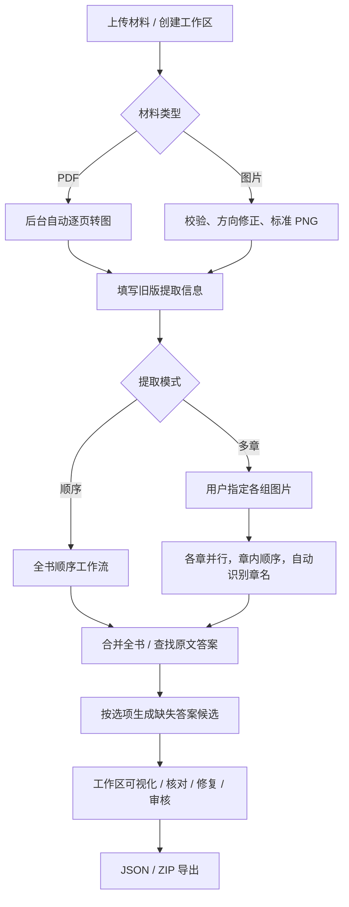

# 工作区流程落地与验证（2026-10-25）

本轮实现后端流程及接口，不包含前端页面或用户容器调度。用户无需知道目录：选择工作区、上传材料、填写旧版信息、查看结果和审核候选即可。30 个 HTTP 接口中新增 8 个工作区接口，完整契约在构建产物 dist/contracts/openapi.json。

## 使用流程

旧表单保留 version、courseId、textbookId、title、publisher、subject、hasAnswer、answerHandlingMode；补充要求保存在 instructions。不增加年级必填项，不接收保存目录。接口默认 prefix 缓存，章名不属于请求字段。

多章分组要求覆盖全部上传页，每页只属于一组。组内页码升序，允许非连续页组；预读限制在组内。章节名称未识别时提示审核，不捏造名称。自动转图期间只能查看进度或取消；准备结束后才允许提交提取设置。

## 可视化与恢复

GET /api/workspaces/:id 返回步骤和允许操作、页图 URL、全书正式 JSON、章节阶段预览、审核候选及根教材任务的问题记录。预览与正式内容均使用全书页码和归一化坐标。前端不遍历服务器目录。

章节失败时不发布不完整的全书修订；恢复保留已完成章节，复用失败章节检查点。取消及退出向模型请求传递中断信号。服务重启标记 interrupted，并清除根教材残留编排锁；显式恢复后继续。修复和答案先产生候选，用户接受后再进入正式导出。

文件、PDF 渲染、模型通信、缓存持久化均位于基础设施适配器；工作区编排通过仓储和资源端口访问。新 AI 能力或数据库读取可加入独立用例及端口，不需要将其塞进 Controller 或识题循环。分层与源码文件长度由架构测试约束。

## 验证证据

`npm run check` 已通过构建、OpenAPI 校验、TypeScript 及全部 45 项自动化测试；运行时依赖审计为 0 项漏洞。新增覆盖：图片顺序和格式、PDF 自动转图、提取前状态限制、分组完整性、全书来源映射、失败/取消/重启恢复、删除级联、旧版答案选项、元数据作为模型输入数据，以及前缀缓存持久化/并发复用/过期重建。

真实模型端测使用原创两页 PDF，一页算术、一页几何，执行真实 Poppler、HTTP 和外部模型调用。最终验证通过：

- PDF 上传后自动转为两张图片；图片上传入口同样创建可用工作区。
- 两组图片并行提取，自动识别 Arithmetic / Geometry 章名。
- 全书题目 ID 无冲突，来源页为 1 和 2。
- 缺答案生成 5 和 12，均为 ai_generated 待审候选。
- 10 条成功 Skill 调用记录累计 11,076 个缓存命中 token；不包含缓存种子请求数或 HTTP 重试数。

脱敏结果：[workspace-live-2026-10-25.json](verification/workspace-live-2026-10-25.json)。复现命令：先配置模型环境变量并构建，然后 `npm run test:live:workspaces`。真实测试单独触发，会调用付费模型。该样本证明链路可用，不代表复杂整本课本的识别准确率。

## 前缀缓存实现与边界

当前显式前缀缓存适配方舟 Responses：固定受控 Skill 指令和输出 schema 作为缓存种子，后续调用引用种子，教材信息、补充要求和图片留在当前输入中。不会把不同章节的动态输出串成历史。缓存按工作区、模型、供应商和指令隔离，到期后重建。

真实接口验证确认启用缓存时后续请求同样需要 store=true，否则返回 400；实现已修正。供应商侧请求保留时间设为一小时，本地只保存种子 ID 和到期时间，不保存 API 密钥。其他供应商可显式 cache=off，或新增对应缓存适配器。协议参考：[方舟上下文缓存](https://docs.volcengine.com/docs/ark/context-cache?lang=en)、[Responses API](https://docs.volcengine.com/docs/ark/create-model-responses-api?lang=zh)。

每个数据卷仍只能由一个进程独占；用户管理、多租户控制平面及分布式 worker 未在本轮实现。图片导入保存标准化 PNG，不额外保留原始上传字节；PDF 保留原件。旧教材底层接口保留用于审核、修复和兼容，新前端上传应统一使用工作区接口。
